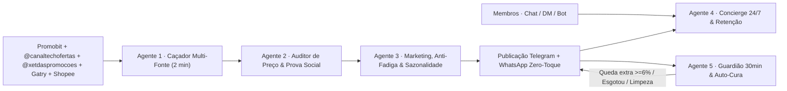

# Salvamento Estruturado do Projeto Ofertô (Evolução Autônoma Multi-Agente)

> Este documento registra passo a passo o diagnóstico, benchmark competitivo, arquitetura dos **5 Agentes Especialistas Autônomos** e cada salvamento incremental validado por testes e commit no Git.

---

## 📊 Diagnóstico do Produto vs. Benchmark de Concorrentes (BR)

| Concorrente | Ponto Forte no Mercado | Estratégia Adaptada para o **Ofertô** (Custo R\$ 0) |
|---|---|---|
| **Pelando** | Alertas por palavra-chave + histórico ("termômetro" de preço real) + validação comunitária rápida | Termômetro anti-"metade do dobro" (`lib/mercado.js`: Zoom + Amazon) + alertas pessoais `/alerta` com **expansão de sinônimos** (`ps5` ↔ `playstation 5`, `airfryer` ↔ `air fryer`) + comparação social exibida no post. |
| **Promobit** | Curadoria em tempo real por loja/nicho + destaque em cupons/horários críticos (ex.: 19h) | Scraper SSR em 28 lojas + 7 categorias + hub de cupons, combinado a regras rígidas contra cupons exclusivos de concorrentes e detecção automática de resgate prévio (`FULL1811`). |
| **Gatry** | Curadoria comunitária direta e enxuta + ritmo constante de achados do varejo BR | Parser público `lerGatryHtml` + desempacotamento multi-salto com limpeza integral de tags alheias. |
| **Canaltech Ofertas / Xet das Promoções** | Links próprios (`link.amazon` → `amzlinks.in`, `meli.la`), ganchos conversacionais e agilidade em quedas relâmpago | Canais públicos Telegram curados (`@canaltechofertas`, `@xetdaspromocoes`) via `t.me/s/`, decodificação `R&#036;`, desempacotamento automático que **remove tags concorrentes** e substitui pelo título/imagem oficial direto da loja. |
| **DivulgaVIP / DivulgaNinja / Shozap / FluxoPromo** | Conversão multi-canal automática (Telegram + WhatsApp), templates curtos, concierge e cadência inteligente | Copy enxuta de 4–5 linhas, piloto compacto no privado do admin, Concierge 24/7 em linguagem natural no chat aberto/DM, e conector HTTP Zero-Toque opcional para WhatsApp (Evolution API / WAHA / Webhook). |

---

## 🤖 Arquitetura dos 5 Agentes Autônomos (`lib/agentes.js`)

### Papel de cada Agente
1. **🕵️ Agente 1 · Caçador Multi-Fonte (`agentes.cacador`)**: Coleta multi-fonte sem custo extra (Promobit 28 lojas/7 nichos + canais Telegram curados `@canaltechofertas` e `@xetdaspromocoes` + Gatry), decodifica `R&#036;` e imagens do `t.me/s/` e desempacota até 3 saltos incluindo `link.amazon` → `amzlinks.in` limpando 100% dos afiliados de terceiros.
2. **⚖️ Agente 2 · Auditor de Preço & Prova Social (`agentes.auditor`)**: Compara no Zoom + busca Amazon antes de publicar, barra armadilhas e recalibra `De R$`, exibindo prova social objetiva da concorrência direto no post (`📊 (R$ X · Concorrente)`).
3. **📣 Agente 3 · Marketing, Anti-Fadiga & Sazonalidade (`agentes.marketing`)**: Evita sequências repetidas da mesma loja/categoria considerando os últimos **90 minutos** publicados (`calcularPenalidadeFadigaRecente`), dá **+14 pontos** para lojas já monetizando (`temAfiliadoAtivo`), dispara o **Esquenta das 18h45** (antes dos lotes de cupons das 19h), Top 5 às 21h15 e divulgação cruzada às 22h05.
4. **🤝 Agente 4 · Concierge 24/7 & Retenção (`agentes.concierge`)**: Responde perguntas naturais no tópico aberto (`💬 Bate-papo & Pedidos`), discussão dos canais e DM (*"tem air fryer até 300?"*, *"cupom ml"*), expande sinônimos em buscas/alertas e oferece botão 1-toque `[🔔 Me avise quando cair]`.
5. **🛡️ Agente 5 · Guardião 30min & Zero-Toque (`agentes.guardiao`)**: Varre ofertas a cada 30 min (`15,45 8-23 * * *`), encerra esgotadas, edita o post ao vivo se houver queda extra `>= 6%` (`📉 BAIXOU AINDA MAIS!`), expira pendentes `> 18h`, reduz ruído em `/modo piloto` (`notificacao_piloto = compacta`) e espelha WhatsApp API quando configurada.

---

## 📍 Linha do Tempo dos Salvamentos

### ✅ Salvamento 1/4 — Núcleo dos 5 Agentes + Agentes 1, 2 e 3 (Concluído)
- [x] Criado [`lib/agentes.js`](../lib/agentes.js) e exportado em [`lib/index.js`](../lib/index.js) seguindo rigorosamente o sandbox n8n (zero `new URL(`, `Buffer.`, `require('crypto')`, `URLSearchParams`, `TextEncoder`).
- [x] **Agente 1 (`cacador`)**: `link.amazon` e `amzlinks.in` adicionados em [`lib/curtos.js`](../lib/curtos.js) e [`lib/extrator.js`](../lib/extrator.js); decodificador `&#036;` + filtragem de ganchos interrogativos + imagens normalizadas em `lerCanalTelegramPublico`, parser `lerGatryHtml`, fontes curadas (`canaltechofertas`, `xetdaspromocoes`, `gatry.com`) no modo agendado e enriquecimento automático do título oficial da loja em [`lib/radar.js`](../lib/radar.js).
- [x] **Agente 2 (`auditor`)**: Adicionada prova social inline da concorrência em `blocoPreco` (`lib/textos.js`) quando `ref_mercado` está pelo menos 12% e R\$ 15 acima do preço publicado, mantendo o post enxuto em 4–5 linhas.
- [x] **Agente 3 (`marketing`)**: Adicionado bônus `+14` para lojas com afiliado ativo (`avaliarBoostMarketing`) e penalidade anti-fadiga considerando os últimos 90 min (`calcularPenalidadeFadigaRecente`), além de busca/filtragem com sinônimos em `bateTermo`.
- [x] **Validação**: `npm test` — `77/77` testes passando sem regressões.

### ✅ Salvamento 2/4 — Configuração, `/agentes`, Concierge 24/7 & Sinônimos (Concluído)
- [x] **[`lib/config.js`](../lib/config.js)**: Adicionadas chaves `agentes.cacador|auditor|marketing|concierge|guardiao`, `radar.canais_curados`, `cupons.esquenta_19h`, `cupons.ultimo_esquenta`, `admin.notificacao_piloto`, `topico_chat_aberto` e `whatsapp.webhook_url|api_key|grupo_destino|canal_destino` (`whatsapp.api_key` protegida fora do chat); `/modo piloto` grava `admin.notificacao_piloto = compacta`.
- [x] **[`lib/telegram.js`](../lib/telegram.js)**: Adicionado comando `/agentes` (painel HTML e toggles `/agentes ligar|pausar <1..5|nome|todos>`), roteamento de intenção natural no chat aberto (`topico_chat_aberto`), grupos de discussão e DM do bot publicador sem interferir nos tópicos fechados de ofertas nem em conversas comuns (`"oi pessoal"` continua `ignorar`).
- [x] **[`lib/comunidade.js`](../lib/comunidade.js)**: Implementado `modo === 'concierge'` em `responderVitrineMembro` com anti-flood de 5 min por membro, resposta na thread com teto de preço e botão 1-toque de alerta; expansão automática de sinônimos aplicada tanto no Concierge quanto no `/buscar` e em `dispararAlertasOferta`.
- [x] **Validação**: Adicionado teste completo do Agente 4 / Sinônimos / `/agentes` em [`tests/comunidade.test.js`](../tests/comunidade.test.js) — `78/78` testes aprovados (`0` falhas).

### ✅ Salvamento 3/4 — Agente 5 (Guardião 30min + Queda Extra + Esquenta 18h45), Piloto Compacto, WhatsApp Zero-Toque, Auditoria QA & Workflows (Concluído)
- [x] **Agente 5 (`guardiao`) em [`lib/comunidade.js`](../lib/comunidade.js) e [`build/build-workflows.js`](../build/build-workflows.js)**: Cron atualizado para a cada 30 min (`15,45 8-23 * * *`), varredura de até 10 ofertas (`>= 20 min`), detecção automática de queda extra `>= 6%` e `>= R$ 5` com recalibração de `desconto_pct` e edição ao vivo do post (`📉 BAIXOU AINDA MAIS!`), expiração silenciosa de pendentes `> 18h` e disparo do **Esquenta de Cupons 18h45** para os lotes das 19h.
- [x] **Piloto Compacto & WhatsApp API em [`lib/radar.js`](../lib/radar.js), [`lib/fluxos.js`](../lib/fluxos.js) e [`build/build-workflows.js`](../build/build-workflows.js)**: Quando `admin.notificacao_piloto = compacta`, elimina card preliminar no privado do admin e entrega 1 mensagem única com resumo + WhatsApp Grupo + botões `[📲 Zap] [⭐ Top] [⛔ Encerrar]`; opcionalmente dispara HTTP POST Zero-Toque (`Webhook WhatsApp auto` / `Webhook WhatsApp radar`) para Evolution API, WAHA ou Webhook Genérico.
- [x] **Auditoria Independente (`AgenteAuditorQA`) & Correções Críticas Aplicadas**:
  - Desacoplado `Auto radar?` diretamente de `Finalizar radar` (evitando interrupção quando `chamadas` é vazio no piloto compacto).
  - Substituído `$json` por `$input.first().json` em `Preparar mercado oferta`, `Disparar alertas oferta?` e `Disparar alertas radar?` (eliminando risco de `ReferenceError` no n8n v2).
  - Refinado parser decimal (`parsePreco`) e anti-flood com limpeza de memória no Concierge (`lib/agentes.js`, `lib/comunidade.js`).
- [x] **Documentação & Build**: `README.md` atualizado, `docs/CONFIG.md` regenerado e os 8 workflows recompilados (`npm run build`).
- [x] **Validação**: `npm test` — `79/79` testes passando (incluindo testes VM dos novos Code nodes e conexões do workflow `04` e `05`).

### ✅ Salvamento 4/4 — Deploy em Produção, Sincronização SQLite, Validação ao Vivo & Push Git (Concluído — 100%)
- [x] **Deploy Docker (`servidor-local`)**: Todos os 8 workflows reimportados e publicados via `docker compose run --rm preparar` com `oferto-n8n-1` e `oferto-vigia-1` em execução saudável (`running`).
- [x] **Sincronização SQLite (`bfx_config` / `data_table_user_42N5LGlb4Wm5TyCN`)**:
  - Ativados: `agentes.cacador=sim`, `agentes.auditor=sim`, `agentes.marketing=sim`, `agentes.concierge=sim`, `agentes.guardiao=sim`, `radar.canais_curados=sim`, `cupons.esquenta_19h=sim`, `admin.notificacao_piloto=compacta` (`topico_chat_aberto=174` mantido; nenhum segredo exibido).
- [x] **Verificação em Produção**:
  - `GET http://127.0.0.1:5678/healthz` → `{"status":"ok"}`
  - `POST http://127.0.0.1:5678/webhook/oferto-saude` → `{"ok":true,"problemas":[],"avisos":0}`
  - Teste ao vivo das fontes curadas via `lerCanalTelegramPublico`: `canaltechofertas` (**18** ofertas com imagem e `s.shopee.com.br`) e `xetdaspromocoes` (**19** ofertas com imagem, `R$` decodificado e `link.amazon` pronto para desempacotamento).
  - Suíte completa `npm test`: **79/79** testes passando em produção local (`0` falhas).

### 🔧 Auditoria 18/11 — radar parado, posts sem foto e promoções sem desconto real
- **Causa do radar parado:** o deploy de 18/11 (05:22) trouxe a tabela nova `bfx_alertas`, mas o **00 · Setup** não foi rodado de novo. O nó "Alertas radar" falhava com `Data table with name "bfx_alertas" not found` e o workflow 04 parava inteiro a cada 2 min, sem publicar nada. Reproduzido num n8n 2.47.7 de teste.
  - Correção: o radar cria a `bfx_alertas` sozinho (`createIfNotExists`) e todo nó dessa tabela segue em frente se ela faltar.
- **Posts sem imagem:** desde 7c5b805 as imagens do Promobit iam por `wsrv.nl` (algumas davam 404, ex.: `/static/p/*.webp`) e só apareciam como prévia de link, que o Telegram nem sempre mostra.
  - Correção: CDN direto `i.promobit.com.br/500/…` (testado: devolve JPEG/PNG) e posts saem como **foto** (`sendPhoto`), com reenvio automático como texto com prévia se a foto for recusada. Edições (Encerrar, "baixou ainda mais", esgotado) mandam texto e legenda.
- **Promoção falsa:** posts de canais do Telegram entravam com `likes: 5` fixo e passavam no filtro mesmo sem desconto. Agora há a trava `avaliarOfertaReal` (prova numérica de economia) e o pré-filtro exige desconto, cupom ou queda de preço. Recusadas ficam 6 h fora (memória do workflow).
- **Reenvio no radar:** a publicação do radar não tinha o reenvio do limite do Telegram (429) que o `/oferta` manual tem. Agora tem, com 700 ms entre mensagens.
- **Desconto velho:** quando a página da loja mostrava preço maior que o anunciado, o % antigo continuava. Agora é recalculado.
- **Validação:** `npm test` 88/88 e teste de ponta a ponta no n8n 2.47.7 com as fontes reais (Promobit, t.me, Zoom): tabela recriada, 3 ofertas reais publicadas como foto no tópico + Top, e fallback para texto quando a foto é recusada.

### 🔧 Correção 18/11 (tarde) — imagens `telesco.pe` sem foto no Telegram e queda de volume por Promobit 429
- **Causa das ofertas sem imagem (`exec 651` e recentes no SQLite):** ofertas vindas dos canais do Telegram (`@canaltechofertas`, `@xetdaspromocoes`) chegavam com URL efêmera `cdn1.telesco.pe/file/...` (404/recusada pelo `sendPhoto` com `Bad Request: failed to get HTTP URL content`). Mesmo quando `Ler páginas radar` lia a página real da loja (ex.: Amazon `200 OK`, `hiRes` `m.media-amazon.com`), `enriquecerCandidatosComPaginas` e `juntarPagina` só substituíam imagens `promobit.com.br` ou `wsrv.nl`, mantendo a `telesco.pe` quebrada. Além disso, o fallback `sendMessage` tentava usar `telesco.pe` na `link_preview_options`.
  - Correção: `telesco.pe`, `telegram.org` e `t.me` passam a ser substituídos pela foto real extraída da loja (`lerPaginaProduto`) ou do comparador (`av.imagem_mercado`); reforçada a extração de imagem na Amazon (incluindo fallback sobre `og:image` com selo `_BO30`) e no Mercado Livre; `postGrupo` nunca usa `telesco.pe` no `link_preview_options` de fallback.
- **Causa da queda drástica de promoções (`exec 257..678`):** desde `06:44 UTC`, `Abrir redir 1` recebia **HTTP 429** em 100% dos `/Redirect/to/<id>/` do Promobit por excesso de rajadas a cada 2 min; o radar desperdiçava quase todas as vagas do ciclo com Promobit e nunca deixava a janela de rate-limit esfriar, além de 4 categorias do Promobit retornarem 404.
  - Correção: removidas as 4 URLs 404 do Promobit; `aplicarRedirRadar1` detecta `429` no Promobit e grava cooldown de 20 min em `staticData` (`pb_redir_bloqueado_ate`), liberando todas as vagas para fontes funcionais (canais Telegram, Shopee) até recuperar; limite de 4 `/Redirect/to/` por ciclo e `batchInterval` aumentado para `400 ms`; links `/social/` do ML vindos do 1º salto agora seguem para `Abrir vitrine 3` em vez de serem aceitos como URL de produto.
- **Validação:** `npm run build` + `npm test` (`90/90` passando) e redeploy em `servidor-local`.

### 🔧 Correção 18/11 (Rodada 2 `/boost`) — logos genéricos Amazon `/images/G/`, `og:image` relativo `//` e `wsrv.nl` no mercado
- **Ajustes ([lib/extrator.js](file:///C:/Users/tHg/Documents/Oferto/lib/extrator.js), [lib/radar.js](file:///C:/Users/tHg/Documents/Oferto/lib/radar.js), [tests/radar-auditoria.test.js](file:///C:/Users/tHg/Documents/Oferto/tests/radar-auditoria.test.js)):**
  - `lerPaginaProduto` passou a descartar logos genéricos da Amazon (`/images/G/`), aceitar `&quot;` em `data-a-dynamic-image` e casar `landingImage` independentemente da ordem de `id`/`src`; também passou a aceitar URLs protocol-relative `//...` em `og:image`/`twitter:image`.
  - `aplicarMercadoNosCandidatos` em `lib/radar.js` agora também substitui `wsrv.nl` pela `imagem_mercado` normalizada quando disponível.
- **Validação:** `npm test` (**91/91** passando, `0` falhas), `GET /healthz` (`ok`), `POST /webhook/oferto-saude` (`{"ok":true,"problemas":[],"avisos":0}`), execuções recentes `689`, `692`, `693`, `695` de `wfRadar000000001` em `success` e últimas ofertas `bfx_ofertas` (`id 67–76`) publicadas com URLs reais de imagem (`http2.mlstatic.com`, `m.media-amazon.com`, `image.zst.com.br`).

### 🔧 Correção 18/11 (Rodada 3 `/boost`) — Classificação estrita de categorias + copy enxuta sem poluição de botões
- **Classificação & Anti-vazamento ([radar.js](file:///C:/Users/tHg/Documents/Oferto/lib/radar.js), [extrator.js](file:///C:/Users/tHg/Documents/Oferto/lib/extrator.js), [fluxos.js](file:///C:/Users/tHg/Documents/Oferto/lib/fluxos.js)):**
  - `lerPromobitHtml`: `categoria_hint` só é herdado por itens de `serverOffers`, nunca por `serverFeaturedOffers` ou `sidebarFeaturedOffers`.
  - `selecionarCandidatosRadar` & `finalizarRadar`: não descartam prematuramente itens enriquecíveis em `/radar <categoria>`, revalidam `catsPerm` após enriquecimento e descartam `sem_categoria` também quando `modoAuto` (`radar.publicar_direto`) está ativo.
  - `enriquecerCandidatosComPaginas`: reclassifica com `lido.titulo` no contexto e substitui `/images/G/`.
  - `avaliarNovaOferta` (`lib/fluxos.js`): não herda `rep.anterior.categoria` errado quando `classificarCategoria` tem `confianca > 0`.
  - `PALAVRAS_CAT` (`lib/extrator.js`): removido `'pet '` genérico de `casa` (evitando falso positivo em `"Frasco PET"`) e ampliadas marcas/termos de `perfumes`.
- **Copy Enxuta & Botões Limpos ([textos.js](file:///C:/Users/tHg/Documents/Oferto/lib/textos.js), [copy.js](file:///C:/Users/tHg/Documents/Oferto/lib/copy.js), [comunidade.js](file:///C:/Users/tHg/Documents/Oferto/lib/comunidade.js)):**
  - Removido o rodapé longo (`🕒 Preço e disponibilidade..., sujeitos a alteração. Frete: confira na loja. · Preço com cupom...`) dos posts do Telegram; mantido `#publi` na 1ª linha e a frase obrigatória de Associado apenas em posts da Amazon.
  - `ganchoOferta` prioriza ganchos curtos ligados ao produto antes de frases genéricas.
  - Nome do produto já aponta diretamente para o link de afiliado da loja e o cupom/link da aba de cupons permanece no corpo do texto; removidos os botões poluídos (`🛒 Ver no ...`, `🎟️ Resgatar Cupons ...`, `🔔 Criar alerta`, `📲 Mandar no Zap`).
- **Validação:** `npm run build` OK (8 workflows), `npm test` (**94/94** passando, `0` falhas), redeploy em `servidor-local` (`GET /healthz` = `ok`, `POST /webhook/oferto-saude` = `{"ok":true,"problemas":[],"avisos":0}`), execuções `715`–`723` de `wfRadar000000001` em `success` e `id 91` (`POLO RED`) classificado corretamente em `perfumes`.

### 🔧 Correção 18/11 (Fim de tarde) — Trava de repost >= 5% (>= R$ 1) + parcelamento sem juros/total sempre exibido
- **Repost mínimo de 5% ([lib/extrator.js](file:///C:/Users/tHg/Documents/Oferto/lib/extrator.js)):** `avaliarRepeticao24h` (janelas de 24h e 72h) passou a exigir queda mínima de **>= 5% e >= R\$ 1,00** para liberar repost de preço menor, evitando notificações por centavos (ex.: R\$ 25,77 -> R\$ 25,00).
- **Parcelamento sem juros & total parcelado ([lib/extrator.js](file:///C:/Users/tHg/Documents/Oferto/lib/extrator.js), [lib/textos.js](file:///C:/Users/tHg/Documents/Oferto/lib/textos.js)):**
  - `htmlParaTexto` remove tags HTML antes do parsing em Amazon, Mercado Livre (incluindo JSON `"quantity"/"amount"/"rate"` e centavos separados por ``) e lojas gerais, calculando o valor da parcela quando o anúncio informa apenas `"Xx sem juros"` e atualizando `recalcularParcelamentoComCupom`.
  - `blocoPreco` passou a exibir uma linha própria e limpa `💳 <b>10x de R$ ... sem juros</b>` (e `<i>(total R$ ...)</i>` quando o total parcelado é maior que o valor à vista/Pix).
- **Validação:** `npm run build` + `npm test` (**95/95** passando, `0` falhas, com novo teste em [tests/radar-auditoria.test.js](file:///C:/Users/tHg/Documents/Oferto/tests/radar-auditoria.test.js)), redeploy concluído em `servidor-local` (`GET /healthz` = `ok`, `POST /webhook/oferto-saude` = `{"ok":true,"problemas":[],"avisos":0}`).

### 🔧 Correção 18/11 (Noite/Fim de tarde) — Preservação do cupom real (`BLACK100OFF`), Compra com Recorrência & Post Amazon ainda mais limpo
- **Proteção contra cupom parcial ([lib/extrator.js](file:///C:/Users/tHg/Documents/Oferto/lib/extrator.js), [lib/radar.js](file:///C:/Users/tHg/Documents/Oferto/lib/radar.js)):**
  - `lerPaginaProduto` passou a varrer todos os blocos de cupom da Amazon (`blocosIndiv` + `blocosCont`) com suporte a *"R$ X de desconto / off"*, e `enriquecerCandidatosComPaginas` não sobrescreve mais um preço menor já calculado com cupom real (ex.: R\$ 961 com `BLACK100OFF`) pelo cálculo de outro cupom menor na página (ex.: R\$ 25 = R\$ 1.036,09), evitando falso repost depois.
- **Compra com Recorrência / Programe e Poupe ([lib/extrator.js](file:///C:/Users/tHg/Documents/Oferto/lib/extrator.js), [lib/radar.js](file:///C:/Users/tHg/Documents/Oferto/lib/radar.js), [lib/textos.js](file:///C:/Users/tHg/Documents/Oferto/lib/textos.js)):**
  - Detecta blocos `snsAccordionRow`/`snsPrice`/*"Comprar com recorrência"*/"Programe e Poupe" na Amazon e menções em texto; calcula/exibe `🔄 <b>Com recorrência: R$ ...</b> (-X%) <i>(cancele grátis a qualquer momento)</i>`.
- **Remoção da frase da Amazon nos posts do Telegram ([lib/textos.js](file:///C:/Users/tHg/Documents/Oferto/lib/textos.js)):**
  - Removido `"Como Associado da Amazon, ganhamos com compras qualificadas."` do corpo de `textoTelegram` (mantido `#publi` na 1ª linha).
- **Validação:** `npm run build` OK (8 workflows), `npm test` (**96/96** passando, `0` falhas), redeploy concluído em `servidor-local` (`GET /healthz` = `ok`, `POST /webhook/oferto-saude` = `{"ok":true,"problemas":[],"avisos":0}`).

### 🔧 Melhoria 18/11 (Noite) — Reconhecimento automático de tags sazonais (`Black Friday`, `11.11`, `12.12`, `01.01`, `Fim de Ano`, `Natal`, etc.)
- **Detecção automática ([lib/extrator.js](file:///C:/Users/tHg/Documents/Oferto/lib/extrator.js), [lib/radar.js](file:///C:/Users/tHg/Documents/Oferto/lib/radar.js)):**
  - Adicionado `detectarTagCampanha` com suporte a `Black Friday` / `Esquenta Black Friday`, `Cyber Monday`, `Prime Day`, datas duplas (`01.01`..`12.12`, ignorando preços como `R$ 11.11`), `Semana do Consumidor`, `Fim de Ano` e promoções sazonais (`Natal`, `Páscoa`, `Dia das Mães/Pais/Namorados/Crianças`) sem falsos positivos em títulos como *"Árvore de Natal"*.
  - Lê selos específicos das páginas da Amazon (`dealBadge`), Mercado Livre (`ui-pdp-promotions-pill`, `andes-badge`), Promobit (`offerTags`) e posts de canais/mensagens manuais.
- **Exibição nos anúncios ([lib/textos.js](file:///C:/Users/tHg/Documents/Oferto/lib/textos.js)):**
  - `primeiraLinha` destaca o selo visual e a hashtag da campanha na 1ª linha do post (ex.: `🖤 BLACK FRIDAY · ... · #BlackFriday #publi`, `🔥 11.11 · ... · #Oferta1111 #publi`, `🎆 FIM DE ANO · ... · #FimDeAno #publi`) e `cardAprovacao` exibe a campanha identificada.
- **Validação:** `npm run build` OK (8 workflows), `npm test` (**97/97** passando, `0` falhas, com suíte em [tests/radar-auditoria.test.js](file:///C:/Users/tHg/Documents/Oferto/tests/radar-auditoria.test.js)), redeploy concluído em `servidor-local` (`GET /healthz` = `ok`, `POST /webhook/oferto-saude` = `{"ok":true,"problemas":[],"avisos":0}`).

### 🔧 Correção + Melhorias 18/11 (`/boost`) — Destravamento do Radar, Fotos via Upload Binário, Magalu, Frete, Tamanhos & Regras Críticas de Estabilidade
- **Causas do novo travamento de promoções corrigidas ([lib/radar.js](file:///C:/Users/tHg/Documents/Oferto/lib/radar.js)):**
  1. **Deadlock infinito no `finalizarRadar`:** candidatos que não resolviam produto (`!c.resolved`, URL `/m/cupom-de-desconto` da Shopee, `/promotion/psp/` da Amazon etc.) davam `continue` sem registrar em `descartadas`, mantendo os mesmos 6 itens ocupando 100% do limite em todas as rodadas. Agora todo descarte não-429 entra em `radar_descartes`.
  2. **Links de resgate de cupom antes do produto (`@canaltechofertas`):** `lerCanalTelegramPublico` prioriza o link do produto sobre links de `"Resgate todos os cupons"` e mantém `redir_url_alts` como fallback automático em `aplicarRedirRadar1`/`2`.
  3. **Chamadas de 1ª linha (`@xetdaspromocoes`) + falso `sem_categoria`:** `pareceChamada` pula hooks como `📢 ...`, `VOLTOU O ...`, `DESPENCOU O ...` quando a Linha 2 traz o título real (ex.: *Perfume Boticário Quasar Blue 100ml* / *Kit com 15 Potes Herméticos*), e `finalizarRadar` reclassifica usando o slug da URL quando o HTML é bloqueado.
  4. **Burst Promobit 429 (`Acesso Bloqueado`):** rotatividade em turnos de `FONTES_CAT_PB` e teto de `3` redirecionamentos Promobit por ciclo.
- **Fotos garantidas & Tamanhos disponíveis ([lib/fluxos.js](file:///C:/Users/tHg/Documents/Oferto/lib/fluxos.js), [build/build-workflows.js](file:///C:/Users/tHg/Documents/Oferto/build/build-workflows.js), [lib/extrator.js](file:///C:/Users/tHg/Documents/Oferto/lib/extrator.js), [lib/textos.js](file:///C:/Users/tHg/Documents/Oferto/lib/textos.js)):**
  - Quando o Telegram recusa baixar a imagem por URL (`failed to get HTTP URL content`, caso comum de `image.zst.com.br` do Zoom e CDNs protegidos), `limiteTelegram` (`tentarBinario: true`) aciona `Baixar foto radar` (enviando `Accept: image/jpeg,image/png,*/*;q=0.8` para evitar resposta `image/webp`) + `Preparar foto radar` (`src.payload && src.bot`) + `Telegram (reenvio foto)` via `httpTelegramArquivo` (`multipart/form-data`) em vez de cair direto para texto puro; `aplicarMercadoNosCandidatos` também faz fallback seguro de imagem do mercado por marca+modelo quando a imagem veio de `telesco.pe` ou vazia.
  - Extração e exibição limpa de **tamanhos disponíveis** (`📏 Tamanhos: ...`) em lojas com variantes legíveis (Amazon/VTEX/JSON-LD) e textos de canais; **nota técnica:** Mercado Livre (`/gz/account-verification`) e Nike (`403` sem sessão) bloqueiam a leitura direta do HTML sem cookies/OAuth.
- **Guardião com resposta imediata em quedas muito altas ([lib/comunidade.js](file:///C:/Users/tHg/Documents/Oferto/lib/comunidade.js)):**
  - Quando uma oferta já publicada cai `>= 15%` extras ou atinge desconto total `>= 35%`, além de editar o post original, o Guardião envia uma **resposta ligada à mensagem anterior** (`reply_parameters`) no tópico/canal com o novo preço, cupom (quando existir) e link de afiliado direto.
- **Outras melhorias entregues ([lib/lojas.js](file:///C:/Users/tHg/Documents/Oferto/lib/lojas.js), [lib/links.js](file:///C:/Users/tHg/Documents/Oferto/lib/links.js), [lib/config.js](file:///C:/Users/tHg/Documents/Oferto/lib/config.js), [lib/agentes.js](file:///C:/Users/tHg/Documents/Oferto/lib/agentes.js), [lib/curtos.js](file:///C:/Users/tHg/Documents/Oferto/lib/curtos.js), [lib/index.js](file:///C:/Users/tHg/Documents/Oferto/lib/index.js)):**
  - Suporte completo à **Magalu** (`magalu`, `magazineluiza.com.br` / `magazinevoce.com.br`), extração de **frete/frete grátis**, exportação dos módulos `desconto`, `imagem`, `legenda`, `setup-canal` em `lib/index.js`, exclusão de `/setup`/`/resumao`/`/demanda` em `lib/curtos.js`, cooldown Promobit reduzido (`20 min` -> `8 min`), e suporte no WhatsApp automático para **grupos por categoria** (`whatsapp.grupo.<cat>`) + **envio com imagem** (`whatsapp.enviar_imagem`).
- **Validação final:** `npm run build` + `npm run release`, `npm test` (**200/200** passando), `cd render && npm test` (**30/30** passando — **230/230 total**), workflows **v4** importados/publicados no `oferto-n8n-1` (`GET /healthz`, `POST /webhook/oferto-saude`, `publicacao.dry_run=nao` ativo na `bfx_config`).

### 🛡️ Upgrade Final Pré-Lançamento de Canais (`/boost`) — Blindagem Raiz Zero `@`/Watermark, Vitrine `/social/` ML Nativa & Expansão Multi-Fonte
- **Raiz do bug de imagem com `@xetdaspromocoes` / watermark de terceiros:**
  1. `lerCanalTelegramPublico` (`lib/radar.js`) capturava `tgme_widget_message_photo_wrap` (`cdn*.telesco.pe`), que é a imagem editada pelo dono do canal concorrente com a pílula `@xetdaspromocoes` / marca d'água gravada nos pixels.
  2. Quando a página da loja bloqueava (`Mercado Livre` `/gz/account-verification` ou `Nike` `403`) e o título da oferta ainda continha o gancho conversacional da 1ª linha (`"BAIXOU GTA VI NA PRÉ-VENDA PARCELADO..."`, `"corre q o cupom tá esgotando"`), a busca no Zoom/Amazon não encontrava foto substituta.
  3. Em `lib/fluxos.js`, `postGrupo` barrava `telesco.pe` apenas em `imgPreview` (`sendMessage`), mas deixava `comFoto` (`sendPhoto`) enviar `oferta.imagem` (`cdn1.telesco.pe`). E quando o Telegram rejeitava a URL `telesco.pe`, `limiteTelegram` (`tentarBinario: true`) acionava `Baixar foto radar` e fazia upload binário (`multipart/form-data`) da foto com `@xetdaspromocoes` direto no grupo!
- **Blindagem definitiva em 5 camadas (entrada → enriquecimento → validação → publicação → reenvio binário):**
  1. **Camada 1 — Extração Zero-Telesco ([lib/radar.js](file:///C:/Users/tHg/Documents/Oferto/lib/radar.js)):** Removida completamente a leitura de `tgme_widget_message_photo_wrap` em `lerCanalTelegramPublico`. Nenhuma imagem de `t.me/s/` entra no pipeline.
  2. **Camada 2 — Bloqueio centralizado em `normalizarImagemOferta` / `ehImagemProibida` ([lib/lojas.js](file:///C:/Users/tHg/Documents/Oferto/lib/lojas.js)):** Bloqueia na raiz `telesco.pe`, `telegram.org`, `t.me`, `pelando.com.br`, `gatry.com`, `nerdofertas.com`, `ofertou.ai`, redes sociais (`whatsapp.net`, `fbcdn.net`, `cdninstagram.com`, `twimg.com`, `imgur.com`, `ibb.co`), inclusive quando encapsulados dentro de `wsrv.nl/?url=...`, além de logos genéricos `/images/G/`, `_SR1910,1000` e `.svg`.
  3. **Camada 3 — Extração nativa da Vitrine `/social/` do Mercado Livre + `.webp` → `.jpg` ([lib/radar.js](file:///C:/Users/tHg/Documents/Oferto/lib/radar.js), [lib/lojas.js](file:///C:/Users/tHg/Documents/Oferto/lib/lojas.js), [lib/curtos.js](file:///C:/Users/tHg/Documents/Oferto/lib/curtos.js), [lib/extrator.js](file:///C:/Users/tHg/Documents/Oferto/lib/extrator.js)):** `resolverReqs3EmCands` agora invoca `extrairDadosHtmlSocial` **antes** de `lerLocation(r)` em respostas HTML de vitrine `/social/`, extraindo foto oficial `https://http2.mlstatic.com/D_...jpg`, título completo (`poly-component__title`), `preco` (`poly-price__current`), `preco_de`, parcelamento (`poly-price__installments` recalculado com cupom) e selo de campanha (`poly-component__highlight`), pulando a leitura redundante da PDP bloqueada (`_social_enriquecido: true`), exigindo `MLB-?\d{6,}` (ignorando links de menu `c_category_id=MLB1196`) e validando correspondência de tokens mesmo quando há `card-featured` de outro produto.
  4. **Camada 4 — Limpeza de ganchos multi-parágrafo, `@handles`, entidades HTML tipográficas e reconstrução de título por slug ([lib/extrator.js](file:///C:/Users/tHg/Documents/Oferto/lib/extrator.js), [lib/radar.js](file:///C:/Users/tHg/Documents/Oferto/lib/radar.js), [lib/mercado.js](file:///C:/Users/tHg/Documents/Oferto/lib/mercado.js)):** `limparMencoesTerceiros` remove `@handles` e nomes de canais; `decodificarEntidadesWeb` / `decodificarHtml` / `decodificarTextoBasico` decodificam `&rdquo;`, `&ldquo;`, `&rsquo;`, `&lsquo;`, `&ndash;`, `&mdash;`, `&hellip;`, `&deg;`, `&times;` e entidades numéricas; `pareceChamadaOuGancho` e o pré-filtro multi-parágrafo (`\n\n`) descartam chamadas como `"BAIXOU GTA VI NA PRÉ-VENDA PARCELADO..."`, `"KIT PRO SOLTEIRO SAIR DE CASA"`, `"corre q o cupom tá esgotando"`, `"MENOR PREÇO HISTÓRICO? 🔥"`; `tituloDaUrl` reconstrói slugs `/up/MLBU...` ignorando prefixos de vitrine (`botdoafiliado`) antes de consultar o Zoom/Amazon; `PALAVRAS_CAT` refinado para classificar toalhas absorventes em `casa` e relógios analógicos/masculinos/femininos em `moda`.
  5. **Camada 5 — Trava em `postGrupo`, `limiteTelegram`, `linhaOferta`, `comunidade` e `agentes` ([lib/fluxos.js](file:///C:/Users/tHg/Documents/Oferto/lib/fluxos.js), [lib/comunidade.js](file:///C:/Users/tHg/Documents/Oferto/lib/comunidade.js), [lib/agentes.js](file:///C:/Users/tHg/Documents/Oferto/lib/agentes.js), [render/baixar.js](file:///C:/Users/tHg/Documents/Oferto/render/baixar.js)):** `postGrupo` usa `imgLimpa = normalizarImagemOferta(oferta.imagem)` tanto no `sendPhoto` quanto no `sendMessage`; `limiteTelegram` jamais ativa `_tentar_binario` para URLs proibidas; allowlist SSRF do `render/baixar.js` expandida apenas para CDNs oficiais de lojas e catálogo (`zst.com.br`, `kabum`, `vteximg`, `ltwebstatic`, `akamaihd`, etc.).
- **Aumento seguro de frequência, qualidade e automação:**
  - Canais curados expandidos em `CANAIS_CURADOS_RADAR` (`canaltechofertas`, `xetdaspromocoes`, `promobit`, `nerdofertas`), suporte ao encurtador `ofertou.ai`, IDs estáveis `mgl_<id>` na Magalu, remoção de falsos negativos do comparador de mercado (`lib/mercado.js`) em embalagens grandes (`>= 450ml`/`450g`) e kits (`pares`), e remoção de ruído de regras de cupom (`acima de R$ X`, `limite R$ Y OFF`) em `extrairDoTexto`.
- **Remediação retroativa em produção (`bfx_ofertas` + mensagens ao vivo no grupo `-1003927635700`):**
  - Limpos todos os registros históricos no SQLite que continham URLs `telesco.pe` ou títulos de chamada, e editadas ao vivo no Telegram via Bot API (`editMessageMedia` / `editMessageCaption`) as postagens afetadas (incluindo `message_id: 238` do GTA VI).
- **Validação final:** `npm run build` + `npm run release`, `npm test` (**201/201** passando), `cd render && npm test` (**30/30** passando — **231/231 total**).

- **⚠️ O que NÃO pode ser alterado para não quebrar a aplicação:**
  1. **`publicacao.dry_run = 'nao'` na `bfx_config` de produção:** os workflows compilados por `build/build-workflows.js` usam `PORTAO_REAL` — remover/mudar essa chave para `'sim'` ou ausente silencia 100% dos envios ao Telegram.
  2. **Não ligar `lib/desconto.js` (`30d >= 5..10 amostras`) nem `frete_desconhecido` como bloqueio duro agora:** `bfx_precos` ao vivo só tem ~1 dia de histórico (`total: 113`); ativar essa trava antes de acumular 10–30 dias de coleta bloquearia ~100% das ofertas automáticas.
  3. **Não trocar `textoTelegram` pela `lib/legenda.js` nem restaurar o aviso `"Como Associado da Amazon..."`:** `legenda.js` sobrescreveria o formato customizado aprovado (parcelamento, recorrência, Black Friday/11.11, título clicável, zero botões poluídos) e recolocaria a frase da Amazon removida em `356c673`.
  4. **Não exigir `http://render:3000/render` sem subir o perfil Docker `COMPOSE_PROFILES=render`:** hoje o contêiner `render` não faz parte da rede ativa padrão do compose.
  5. **Não alterar o schema de colunas gravadas em `bfx_precos` / `bfx_ofertas` sem criar colunas no SQLite/Data Tables antes:** o n8n recusa inserções com colunas desconhecidas (`limpeza`/`setup`).
  6. **Não dividir `categoria = 'tech'` em `'games'` / `'eletronicos'` em `classificarCategoria` sem antes criar `topico.games` e `topico.eletronicos` na `bfx_config`:** o supergrupo usa `topico.tech`.
  7. **Tokens/URLs no código dos Code nodes não podem usar `new URL(`, `URLSearchParams`, `Buffer.`, `require('crypto')` ou `TextEncoder`** (bloqueados pelo sandbox VM do n8n, validados em `tests/lib.test.js`).
