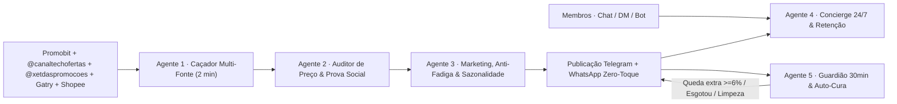

# Salvamento Estruturado do Projeto Ofertô (Evolução Autônoma Multi-Agente)

> Este documento registra passo a passo o diagnóstico, benchmark competitivo, arquitetura dos **5 Agentes Especialistas Autônomos** e cada salvamento incremental validado por testes e commit no Git.

---

## 📊 Diagnóstico do Produto vs. Benchmark de Concorrentes (BR)

| Concorrente | Ponto Forte no Mercado | Estratégia Adaptada para o **Ofertô** (Custo R\$ 0) |
|---|---|---|
| **Pelando** | Alertas por palavra-chave + histórico ("termômetro" de preço real) + validação comunitária rápida | Termômetro anti-"metade do dobro" (`lib/mercado.js`: Zoom + Amazon) + alertas pessoais `/alerta` com **expansão de sinônimos** (`ps5` ↔ `playstation 5`, `airfryer` ↔ `air fryer`) + comparação social exibida no post. |
| **Promobit** | Curadoria em tempo real por loja/nicho + destaque em cupons/horários críticos (ex.: 19h) | Scraper SSR em 28 lojas + 7 categorias + hub de cupons, combinado a regras rígidas contra cupons exclusivos de concorrentes e detecção automática de resgate prévio (`FULL1811`). |
| **Gatry** | Curadoria comunitária direta e enxuta + ritmo constante de achados do varejo BR | Parser público `lerGatryHtml` + desempacotamento multi-salto com limpeza integral de tags alheias. |
| **Canaltech Ofertas / Xet das Promoções** | Links próprios (`link.amazon` → `amzlinks.in`, `meli.la`), ganchos conversacionais e agilidade em quedas relâmpago | Canais públicos Telegram curados (`@canaltechofertas`, `@xetdaspromocoes`) via `t.me/s/`, decodificação `R&#036;`, desempacotamento automático que **remove tags concorrentes** e substitui pelo título/imagem oficial direto da loja. |
| **DivulgaVIP / DivulgaNinja / Shozap / FluxoPromo** | Conversão multi-canal automática (Telegram + WhatsApp), templates curtos, concierge e cadência inteligente | Copy enxuta de 4–5 linhas, piloto compacto no privado do admin, Concierge 24/7 em linguagem natural no chat aberto/DM, e conector HTTP Zero-Toque opcional para WhatsApp (Evolution API / WAHA / Webhook). |

---

## 🤖 Arquitetura dos 5 Agentes Autônomos (`lib/agentes.js`)

### Papel de cada Agente
1. **🕵️ Agente 1 · Caçador Multi-Fonte (`agentes.cacador`)**: Coleta multi-fonte sem custo extra (Promobit 28 lojas/7 nichos + canais Telegram curados `@canaltechofertas` e `@xetdaspromocoes` + Gatry), decodifica `R&#036;` e imagens do `t.me/s/` e desempacota até 3 saltos incluindo `link.amazon` → `amzlinks.in` limpando 100% dos afiliados de terceiros.
2. **⚖️ Agente 2 · Auditor de Preço & Prova Social (`agentes.auditor`)**: Compara no Zoom + busca Amazon antes de publicar, barra armadilhas e recalibra `De R$`, exibindo prova social objetiva da concorrência direto no post (`📊 (R$ X · Concorrente)`).
3. **📣 Agente 3 · Marketing, Anti-Fadiga & Sazonalidade (`agentes.marketing`)**: Evita sequências repetidas da mesma loja/categoria considerando os últimos **90 minutos** publicados (`calcularPenalidadeFadigaRecente`), dá **+14 pontos** para lojas já monetizando (`temAfiliadoAtivo`), dispara o **Esquenta das 18h45** (antes dos lotes de cupons das 19h), Top 5 às 21h15 e divulgação cruzada às 22h05.
4. **🤝 Agente 4 · Concierge 24/7 & Retenção (`agentes.concierge`)**: Responde perguntas naturais no tópico aberto (`💬 Bate-papo & Pedidos`), discussão dos canais e DM (*"tem air fryer até 300?"*, *"cupom ml"*), expande sinônimos em buscas/alertas e oferece botão 1-toque `[🔔 Me avise quando cair]`.
5. **🛡️ Agente 5 · Guardião 30min & Zero-Toque (`agentes.guardiao`)**: Varre ofertas a cada 30 min (`15,45 8-23 * * *`), encerra esgotadas, edita o post ao vivo se houver queda extra `>= 6%` (`📉 BAIXOU AINDA MAIS!`), expira pendentes `> 18h`, reduz ruído em `/modo piloto` (`notificacao_piloto = compacta`) e espelha WhatsApp API quando configurada.

---

## 📍 Linha do Tempo dos Salvamentos

### ✅ Salvamento 1/4 — Núcleo dos 5 Agentes + Agentes 1, 2 e 3 (Concluído)
- [x] Criado [`lib/agentes.js`](../lib/agentes.js) e exportado em [`lib/index.js`](../lib/index.js) seguindo rigorosamente o sandbox n8n (zero `new URL(`, `Buffer.`, `require('crypto')`, `URLSearchParams`, `TextEncoder`).
- [x] **Agente 1 (`cacador`)**: `link.amazon` e `amzlinks.in` adicionados em [`lib/curtos.js`](../lib/curtos.js) e [`lib/extrator.js`](../lib/extrator.js); decodificador `&#036;` + filtragem de ganchos interrogativos + imagens normalizadas em `lerCanalTelegramPublico`, parser `lerGatryHtml`, fontes curadas (`canaltechofertas`, `xetdaspromocoes`, `gatry.com`) no modo agendado e enriquecimento automático do título oficial da loja em [`lib/radar.js`](../lib/radar.js).
- [x] **Agente 2 (`auditor`)**: Adicionada prova social inline da concorrência em `blocoPreco` (`lib/textos.js`) quando `ref_mercado` está pelo menos 12% e R\$ 15 acima do preço publicado, mantendo o post enxuto em 4–5 linhas.
- [x] **Agente 3 (`marketing`)**: Adicionado bônus `+14` para lojas com afiliado ativo (`avaliarBoostMarketing`) e penalidade anti-fadiga considerando os últimos 90 min (`calcularPenalidadeFadigaRecente`), além de busca/filtragem com sinônimos em `bateTermo`.
- [x] **Validação**: `npm test` — `77/77` testes passando sem regressões.

### ✅ Salvamento 2/4 — Configuração, `/agentes`, Concierge 24/7 & Sinônimos (Concluído)
- [x] **[`lib/config.js`](../lib/config.js)**: Adicionadas chaves `agentes.cacador|auditor|marketing|concierge|guardiao`, `radar.canais_curados`, `cupons.esquenta_19h`, `cupons.ultimo_esquenta`, `admin.notificacao_piloto`, `topico_chat_aberto` e `whatsapp.webhook_url|api_key|grupo_destino|canal_destino` (`whatsapp.api_key` protegida fora do chat); `/modo piloto` grava `admin.notificacao_piloto = compacta`.
- [x] **[`lib/telegram.js`](../lib/telegram.js)**: Adicionado comando `/agentes` (painel HTML e toggles `/agentes ligar|pausar <1..5|nome|todos>`), roteamento de intenção natural no chat aberto (`topico_chat_aberto`), grupos de discussão e DM do bot publicador sem interferir nos tópicos fechados de ofertas nem em conversas comuns (`"oi pessoal"` continua `ignorar`).
- [x] **[`lib/comunidade.js`](../lib/comunidade.js)**: Implementado `modo === 'concierge'` em `responderVitrineMembro` com anti-flood de 5 min por membro, resposta na thread com teto de preço e botão 1-toque de alerta; expansão automática de sinônimos aplicada tanto no Concierge quanto no `/buscar` e em `dispararAlertasOferta`.
- [x] **Validação**: Adicionado teste completo do Agente 4 / Sinônimos / `/agentes` em [`tests/comunidade.test.js`](../tests/comunidade.test.js) — `78/78` testes aprovados (`0` falhas).

### ✅ Salvamento 3/4 — Agente 5 (Guardião 30min + Queda Extra + Esquenta 18h45), Piloto Compacto, WhatsApp Zero-Toque, Auditoria QA & Workflows (Concluído)
- [x] **Agente 5 (`guardiao`) em [`lib/comunidade.js`](../lib/comunidade.js) e [`build/build-workflows.js`](../build/build-workflows.js)**: Cron atualizado para a cada 30 min (`15,45 8-23 * * *`), varredura de até 10 ofertas (`>= 20 min`), detecção automática de queda extra `>= 6%` e `>= R$ 5` com recalibração de `desconto_pct` e edição ao vivo do post (`📉 BAIXOU AINDA MAIS!`), expiração silenciosa de pendentes `> 18h` e disparo do **Esquenta de Cupons 18h45** para os lotes das 19h.
- [x] **Piloto Compacto & WhatsApp API em [`lib/radar.js`](../lib/radar.js), [`lib/fluxos.js`](../lib/fluxos.js) e [`build/build-workflows.js`](../build/build-workflows.js)**: Quando `admin.notificacao_piloto = compacta`, elimina card preliminar no privado do admin e entrega 1 mensagem única com resumo + WhatsApp Grupo + botões `[📲 Zap] [⭐ Top] [⛔ Encerrar]`; opcionalmente dispara HTTP POST Zero-Toque (`Webhook WhatsApp auto` / `Webhook WhatsApp radar`) para Evolution API, WAHA ou Webhook Genérico.
- [x] **Auditoria Independente (`AgenteAuditorQA`) & Correções Críticas Aplicadas**:
  - Desacoplado `Auto radar?` diretamente de `Finalizar radar` (evitando interrupção quando `chamadas` é vazio no piloto compacto).
  - Substituído `$json` por `$input.first().json` em `Preparar mercado oferta`, `Disparar alertas oferta?` e `Disparar alertas radar?` (eliminando risco de `ReferenceError` no n8n v2).
  - Refinado parser decimal (`parsePreco`) e anti-flood com limpeza de memória no Concierge (`lib/agentes.js`, `lib/comunidade.js`).
- [x] **Documentação & Build**: `README.md` atualizado, `docs/CONFIG.md` regenerado e os 8 workflows recompilados (`npm run build`).
- [x] **Validação**: `npm test` — `79/79` testes passando (incluindo testes VM dos novos Code nodes e conexões do workflow `04` e `05`).

### ⏳ Próximo e Último Passo
- **Salvamento 4/4**: Redeploy Docker (`servidor-local`), importação dos 8 workflows, sincronização SQLite em `bfx_config`, health checks ao vivo, teste das fontes curadas em produção e push Git para `origin/main`.
